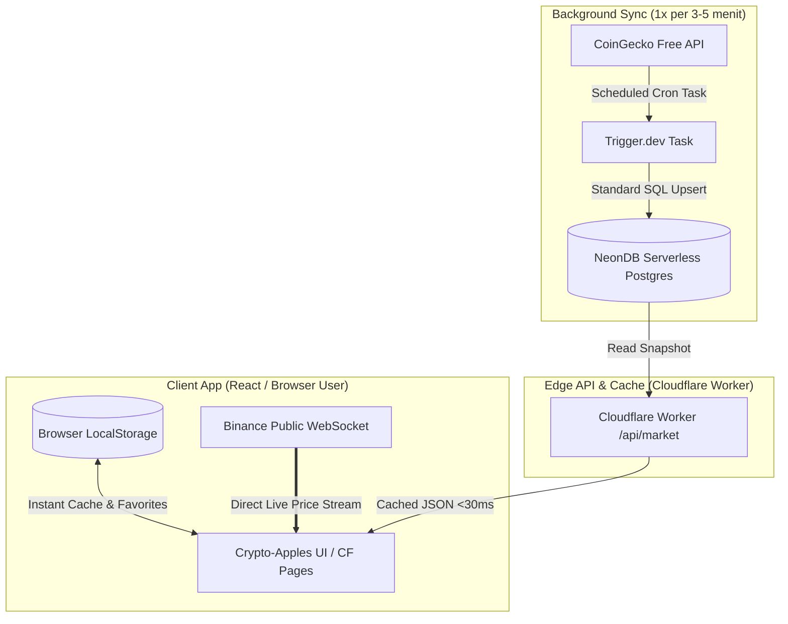

# Arsitektur & Rencana Integrasi API: Crypto-Apples
> **Target:** Arsitektur data terdistribusi yang efisien, 100% gratis selamanya (*Zero-Cost Sustainable Infrastructure*), **bebas vendor lock-in**, kebal *rate-limit*, serta menyajikan data *real-time* bagi pengguna.

---

## 1. Analisis Masalah & Filosofi Desain

### Masalah Utama
1. **CoinGecko Free Tier Rate-Limit:** Batasan ketat ~10–30 request/menit. Jika 100 user membuka browser secara bersamaan dan me-request langsung ke CoinGecko (*Client-to-API*), API akan langsung mengembalikan error **HTTP 429 Too Many Requests**.
2. **Kebutuhan Real-Time vs Biaya:** Harga crypto bergerak setiap detik, namun data makro (Market Cap, FDV, Global Rank) hanya perlu di-refresh setiap beberapa menit.
3. **Resiko Paused pada Free Tier BaaS (seperti Supabase):** Supabase mem-pause proyek setelah 7 hari sepi, yang menimbulkan beban operasional manual.
4. **Vendor Lock-in:** Menghindari ketergantungan pada library proprietary seperti `supabase.js` agar kode portabel dan mudah dimigrasikan kapan saja.

### Solusi: *Diversified Zero-Cost Architecture (CF + NeonDB + Trigger.dev)*
Mendistribusikan beban kerja ke berbagai penyedia layanan terbaik di kelasnya untuk menjaga biaya **$0 selamanya**:



---

## 2. Pemilihan Teknologi Bebas Vendor-Lock ($0 Sustainable Stack)

| Komponen | Pilihan | Kuota Free Tier | Alasan & Karakteristik |
| :--- | :--- | :--- | :--- |
| **Hosting Frontend (UI)** | **Cloudflare Pages** | **Unlimited Bandwidth**, Unlimited Requests | 100% gratis selamanya, tanpa limit kuota 100GB seperti Vercel. |
| **API & Edge Cache** | **Cloudflare Workers** | 100.000 requests/hari | Menyediakan endpoint `/api/market` tipis & *edge caching*. Konfigurasi via `wrangler.json` (standar, mudah dimigrasikan). |
| **Database** | **NeonDB (PostgreSQL)** | 0.5 GB Storage, Serverless Compute | **PostgreSQL standar murni**. **TIDAK ADA resiko 7-day pause** seperti Supabase. Akses via terminal `psql`. |
| **Background Sync** | **Trigger.dev (v3)** | 50.000 runs/bulan | Menjalankan cron job sync ke CoinGecko tiap 5 menit (~8.640 runs/bln). Built-in retry & backoff. Mengurangi beban komputasi di Cloudflare. |
| **Live Price Stream** | **Binance WebSocket** | Bebas kuota / Unlimited | WebSocket mini-ticker publik langsung dari browser user tanpa perlu API key. |
| **Client Storage** | **Browser LocalStorage** | Browser Storage (~5MB) | Simpan koin favorit & snapshot offline. 0 beban server. |

---

## 3. Pembagian Layer Data

### A. Data Statis & Konfigurasi (Promosi & Ticker)
* **Ticker Registry:** Simpan metadata dasar di `src/data/cryptoData.ts` sebagai *offline fallback*.
* **Referral & Iklan:** Simpan di tabel NeonDB `promotions` agar dapat diubah kapan saja tanpa perlu me-redeploy aplikasi.

### B. Data Dinamis Makro (Market Cap, Rank, 24h Vol)
* **Sumber:** CoinGecko API v3 (Public Free).
* **Alur:**
  1. **Trigger.dev** menjalankan scheduled task tiap **5 menit sekali**:
     * Fetch top 100 koin sekaligus dalam 1 request bulk.
     * Upsert data ke tabel `market_snapshots` di NeonDB menggunakan query SQL standar.
  2. **Cloudflare Worker (`/api/market`)** membaca data dari NeonDB dengan *Edge Cache* (TTL 2–3 menit).
  3. Frontend user hanya me-request ke endpoint Cloudflare Worker tersebut.
  * **Hasil:** CoinGecko hanya dihubungi 1x per 5 menit (288 req/hari). Tidak akan pernah terjadi 429 error.

### C. Data Dinamis Mikro (Live Price & Perubahan Detik)
* **Sumber:** Binance WebSocket (`wss://stream.binance.com:9443/ws/!miniTicker@arr`).
* **Alur:** Browser user terhubung langsung ke WebSocket Binance publik. Menggunakan batching 500ms dan otomatis *pause* jika tab tidak aktif (`document.hidden`).

### D. Data Lokal User (Favorites & Watchlist)
* Disimpan di `localStorage` browser. Tanpa perlu akun/auth, 100% instan saat web dibuka.

---

## 4. Skema Database Standar PostgreSQL (NeonDB)

Skema ini adalah **standard ANSI SQL / PostgreSQL murni**, tanpa extension khusus vendor sehingga 100% portabel:

```sql
-- 1. Tabel Koin & Metadata Statis
CREATE TABLE IF NOT EXISTS coins (
    id VARCHAR(50) PRIMARY KEY, -- 'bitcoin'
    symbol VARCHAR(20) NOT NULL UNIQUE, -- 'BTC'
    name VARCHAR(100) NOT NULL,
    category VARCHAR(50) DEFAULT 'Layer 1',
    icon_url TEXT,
    binance_symbol VARCHAR(20), -- 'BTCUSDT' (untuk mapping WebSocket)
    is_active BOOLEAN DEFAULT true,
    created_at TIMESTAMPTZ DEFAULT NOW()
);

-- 2. Tabel Snapshot Pasar (Diupdate oleh Trigger.dev)
CREATE TABLE IF NOT EXISTS market_snapshots (
    symbol VARCHAR(20) PRIMARY KEY REFERENCES coins(symbol) ON DELETE CASCADE,
    price_usd NUMERIC(18, 8) NOT NULL,
    market_cap NUMERIC(24, 2),
    market_cap_rank INT,
    total_volume_24h NUMERIC(24, 2),
    high_24h NUMERIC(18, 8),
    low_24h NUMERIC(18, 8),
    change_24h NUMERIC(8, 4),
    change_7d NUMERIC(8, 4),
    sparkline_7d JSONB, -- Array harga 7 hari terakhir
    updated_at TIMESTAMPTZ DEFAULT NOW()
);

-- 3. Tabel Referral & Ads (Monetisasi Dinamis)
CREATE TABLE IF NOT EXISTS promotions (
    id UUID PRIMARY KEY DEFAULT gen_random_uuid(),
    title VARCHAR(100) NOT NULL,
    type VARCHAR(20) CHECK (type IN ('referral', 'banner', 'ad')),
    target_coins TEXT[] DEFAULT '{}', -- misal: ARRAY['SOL', 'BTC']
    cta_text VARCHAR(100) NOT NULL, -- "Daftar Bybit (Bonus s.d $30k + Diskon Fee 20%)"
    target_url TEXT NOT NULL,
    badge_text VARCHAR(30), -- "Partner Resmi" / "Sponsored"
    priority INT DEFAULT 0,
    is_active BOOLEAN DEFAULT true,
    created_at TIMESTAMPTZ DEFAULT NOW()
);

-- Indexing untuk performa baca cepat
CREATE INDEX IF NOT EXISTS idx_market_rank ON market_snapshots(market_cap_rank);
CREATE INDEX IF NOT EXISTS idx_promo_active ON promotions(is_active, priority DESC);
```

---

## 5. Implementasi Worker Sync (Trigger.dev v3)

Kode background worker ini menggunakan driver standar PostgreSQL (atau `@neondatabase/serverless` standard SQL) tanpa library vendor-locked:

```typescript
// trigger/syncMarket.ts
import { schedules } from "@trigger.dev/sdk/v3";
import { neon } from "@neondatabase/serverless";

// Standard SQL executor via connection string
const sql = neon(process.env.DATABASE_URL!);

export const syncCryptoMarketJob = schedules.task({
  id: "sync-crypto-market",
  cron: "*/5 * * * *", // 1x setiap 5 menit (aman, ~8.640 runs/bln dari kuota 50k)
  run: async () => {
    // 1. Fetch top 100 koin dari CoinGecko (1 request bulk)
    const res = await fetch(
      "https://api.coingecko.com/api/v3/coins/markets?vs_currency=usd&order=market_cap_desc&per_page=100&page=1&sparkline=true&price_change_percentage=24h,7d"
    );

    if (!res.ok) {
      throw new Error(`CoinGecko HTTP Error: ${res.status}`);
    }

    const data = await res.json();

    // 2. Bulk upsert via standard SQL
    for (const item of data) {
      const symbol = item.symbol.toUpperCase();
      await sql`
        INSERT INTO market_snapshots (
          symbol, price_usd, market_cap, market_cap_rank, total_volume_24h,
          high_24h, low_24h, change_24h, change_7d, sparkline_7d, updated_at
        ) VALUES (
          ${symbol}, ${item.current_price}, ${item.market_cap}, ${item.market_cap_rank},
          ${item.total_volume}, ${item.high_24h}, ${item.low_24h},
          ${item.price_change_percentage_24h}, ${item.price_change_percentage_7d_in_currency},
          ${JSON.stringify(item.sparkline_in_7d?.price || [])}, NOW()
        )
        ON CONFLICT (symbol) DO UPDATE SET
          price_usd = EXCLUDED.price_usd,
          market_cap = EXCLUDED.market_cap,
          market_cap_rank = EXCLUDED.market_cap_rank,
          total_volume_24h = EXCLUDED.total_volume_24h,
          high_24h = EXCLUDED.high_24h,
          low_24h = EXCLUDED.low_24h,
          change_24h = EXCLUDED.change_24h,
          change_7d = EXCLUDED.change_7d,
          sparkline_7d = EXCLUDED.sparkline_7d,
          updated_at = NOW();
      `;
    }

    return { total: data.length, timestamp: new Date() };
  },
});
```

---

## 6. Cloudflare Worker API Endpoint (`api/market`)

Contoh endpoint tipis di Cloudflare Worker menggunakan `wrangler.json`:

```typescript
// worker/index.ts
import { neon } from "@neondatabase/serverless";

export default {
  async fetch(request: Request, env: { DATABASE_URL: string }): Promise<Response> {
    const url = new URL(request.url);

    if (url.pathname === "/api/market") {
      const sql = neon(env.DATABASE_URL);
      
      const coins = await sql`
        SELECT m.*, c.name, c.category, c.icon_url, c.binance_symbol
        FROM market_snapshots m
        LEFT JOIN coins c ON m.symbol = c.symbol
        ORDER BY m.market_cap_rank ASC
        LIMIT 100;
      `;

      return new Response(JSON.stringify(coins), {
        headers: {
          "Content-Type": "application/json",
          "Access-Control-Allow-Origin": "*",
          "Cache-Control": "public, max-age=120, s-maxage=180", // Edge cache 2-3 menit
        },
      });
    }

    return new Response("Not Found", { status: 404 });
  },
};
```

---

## 7. Analisis Biaya & Batasan Kuota (100% Free & Terdistribusi)

| Resource | Kalkulasi Pemakaian | Batas Free Tier | Status |
| :--- | :--- | :--- | :--- |
| **Hosting Frontend (UI)** | **Cloudflare Pages** | Unlimited Bandwidth | ✅ **100% Gratis Selamanya** |
| **API & Edge Cache** | **Cloudflare Workers** | 100.000 req / hari | ✅ **Aman (Edge cache mengurangi hit)** |
| **Database** | **NeonDB** | 0.5 GB Storage | ✅ **Aman (<10 MB terpakai, NO PAUSE)** |
| **Background Sync** | **Trigger.dev** | 50.000 runs / bulan | ✅ **Aman (~8.640 runs terpakai / 17%)** |
| **CoinGecko API** | 1 req / 5 menit = 288 req / hari | Max ~10-30 req / menit | ✅ **Sangat Aman (<1% limit)** |
| **Live Price Stream** | **Binance WebSocket** | Bebas kuota / Unlimited | ✅ **Gratis Tanpa Batas** |
| **Total Biaya Infrastruktur** | **$0.00 / bulan** | **100% Zero-Cost** | 🎉 **Bisa berjalan tanpa modal** |

---

## 8. Panduan Monetisasi: Realita Affiliate & Sumber Pendapatan

### A. Apakah Affiliate Exchange Cuma "Potongan Fee" Saja?
> **Jawabannya: TIDAK. Affiliate Exchange adalah komisi UANG TUNAI RIIL (USDT/USD), bukan sekadar kupon diskon!**

* **Affiliate Program (Partner / Kolaborator):**
  * Anda mendaftar sebagai **Affiliate** di exchange (misal: *Bybit Affiliate, Bitget Affiliate, OKX Affiliate, MEXC*).
  * **Mekanisme Payout:** Setiap kali user yang mendaftar lewat link Anda melakukan order (Spot maupun Futures/Leverage), exchange memungut *trading fee*. Dari fee tersebut, exchange membagikan **30% hingga 50% REVENUE SHARE langsung kepada Anda dalam bentuk CASH USDT**.
  * **Contoh Riil:**
    * 1 trader aktif futures dengan volume $50.000 / hari.
    * Trading fee exchange (0.05%) = $25 / hari.
    * Komisi affiliate Anda (40%) = **$10 / hari ($300 / bulan) pasif dari 1 user saja!**
    * Komisi ini masuk ke dompet exchange dan bisa ditarik ke rekening bank (via P2P) kapan saja.

---

### B. 5 Sumber Pendapatan (Revenue Streams) Terbaik untuk Web Ini

1. **Exchange Affiliate Revenue Share (Paling Menguntungkan):**
   * Pasang tombol aksi kontekstual di setiap koin, contoh: *"Beli SOL di Bybit (Bonus Deposit s.d $30.000 + Diskon Fee 20%)"*.
   * Rekomendasi: **Bybit** (30%-50%), **Bitget / MEXC** (40%-60%), **Binance** (30%-40%), **Tokocrypto / Indodax** (Rupiah).
2. **Swap Integrator Fee (DEX Widget):**
   * Di detail koin, integrasikan widget instant swap dari **Jupiter (Solana)**, **1inch**, atau **Li.Fi** dengan integrator fee 0.1%–0.5% langsung ke wallet Anda.
3. **Hardware Wallet Affiliate (Trezor / Ledger / Tangem):**
   * Komisi 10%–15% per penjualan unit hardware wallet (dibayar dalam EUR/USD/Crypto).
4. **"Featured Apple" / Sponsored Coin Listing:**
   * Jual slot koin emas promosi untuk token baru/meme di kanvas fisika apel ($50–$200/minggu).
5. **Crypto-Native Banner Ads (A-Ads / CoinZilla):**
   * Banner iklan Web3 yang membayar CPM/CPC langsung ke Bitcoin/USDT tanpa syarat rumit Google AdSense.

---

## 9. Roadmap Langkah Kerja

- [ ] **Fase 1 (Frontend Refinement):**
  - Implementasikan hook `useFavorites` dengan `localStorage`.
  - Pasang komponen Affiliate Button kontekstual di detail koin (Bybit/Binance/Tokocrypto).
  - Tambahkan optimasi `document.visibilityState` pada `cryptoMarketService.ts`.
- [ ] **Fase 2 (Setup NeonDB & Cloudflare Worker):**
  - Buat database NeonDB (Free Tier) & eksekusi DDL SQL standar.
  - Setup Cloudflare Worker tipis dengan `wrangler.json` untuk endpoint `/api/market`.
  - Deploy frontend ke **Cloudflare Pages** (Gratis, unlimited bandwidth).
- [ ] **Fase 3 (Setup Trigger.dev):**
  - Hubungkan project dengan Trigger.dev (Free Tier).
  - Deploy scheduled cron task sinkronisasi CoinGecko tiap 5 menit ke NeonDB.
- [ ] **Fase 4 (Pendaftaran Affiliate & Monetisasi):**
  - Daftarkan akun ke Bybit Affiliate / MEXC Affiliate.
  - Masukkan affiliate ID ke tabel `promotions`.
